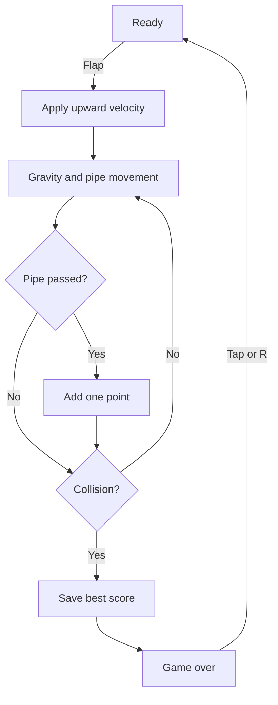

# Sky Skip

A tiny golden-hour flyer built with Vue 3, TypeScript, and Canvas 2D. Guide an original little sunbird between the pipes and see how far you get.

**Play:** [oscarmmi.github.io/flappy](https://oscarmmi.github.io/flappy/)

## How to play

- Press **Space**, **Arrow Up**, click, or tap to flap upward.
- Slip through the pipe gaps to earn a point for each pair.
- Pipes and the ground end your flight. Press **R** or tap to try again.
- Your best distance is saved in this browser.

## Run locally

```sh
npm install
npm run dev
```

Run the pure game-logic tests and production build:

```sh
npm test
npm run build
```

## Game loop



## GitHub Pages

The `main` branch deploys `dist/` through the GitHub Pages Actions workflow. The Vite base path is configured for `/flappy/`.
